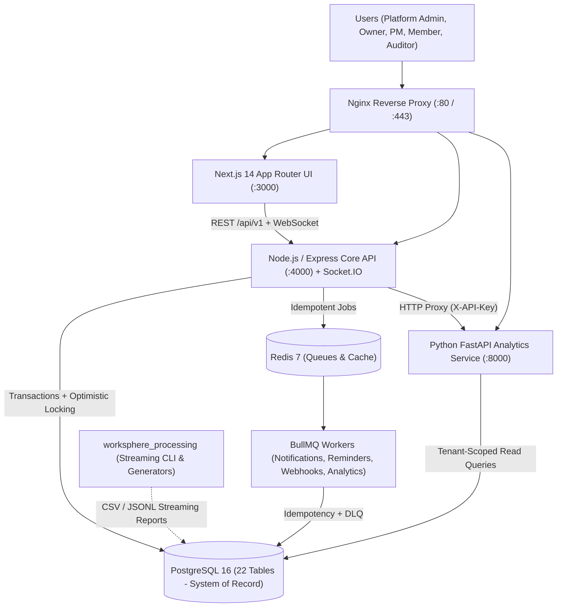

# WorkSphere — Multi-Tenant Project Management & Workflow Automation Platform

WorkSphere is an enterprise multi-tenant SaaS platform built for organizations to plan projects, assign work, collaborate in real time, automate rule-driven workflows, track delivery, and analyze team performance with strict tenant isolation.

## System Architecture Diagram



## Architecture & Project Documentation

- [**System Architecture Blueprint**](docs/architecture/architecture.md) — Service topology, Express middleware pipeline, RBAC matrix, and data ownership
- [**Database ER Diagram & Schema**](docs/architecture/DATABASE_SCHEMA.md) — Full entity-relationship diagrams across all 22 PostgreSQL tables, constraints, and indexes
- [**Service & Data-Flow Diagrams**](docs/architecture/DATA_FLOWS.md) — Sequence & flow diagrams for role-based auth, optimistic locking (`409`), workflows, webhooks, and analytics
- [**Complete Codebase Guide**](docs/architecture/CODEBASE_GUIDE.md) — Annotated directory and module reference across the entire workspace
- [**15-Assessment Matrix**](docs/assessments/README.md) · [**Deployment Guide**](docs/DEPLOYMENT.md) · [**Incident Response**](docs/INCIDENT_RESPONSE.md) · [**OpenAPI Spec**](docs/api/openapi-backend.yaml) · [**Postman Collection**](docs/api/worksphere.postman_collection.json)

---

## Technology Stack

| Layer | Technology | Responsibility |
| --- | --- | --- |
| **Frontend** | Next.js 14 App Router, React 18, TypeScript, Tailwind CSS, TanStack Query, Redux Toolkit, React Hook Form + Zod | Role-based login portal (`platform_admin`, `owner`, `project_manager`, `team_member`, `auditor`), `RoleGuard`, Kanban boards, forms, Socket.IO client |
| **Core API** | Node.js, Express, TypeScript, Knex.js, Zod, BullMQ, Socket.IO, Winston | Versioned REST API (`/api/v1`), JWT + refresh token rotation, RBAC & tenant isolation, optimistic locking, workflow engine, webhooks |
| **Analytics Service** | Python 3, FastAPI, Pydantic v2, SQLAlchemy Async | Independently deployable analytics microservice (`/api/v1/analytics/*`) for project health, workload, cycle time, burndown, reports |
| **Streaming Package** | Python `worksphere_processing` | Memory-efficient generator/iterator CSV & JSONL export processor, productivity metrics, overdue detector, report writer |
| **Data & Cache** | PostgreSQL 16, Redis 7 | System of record (22 normalized multi-tenant tables, transactions, audit logs, DLQ) + BullMQ queues (with sync DB fallback if Redis disabled) |
| **Infra & CI/CD** | Docker, Docker Compose, Nginx, GitHub Actions | Multi-stage non-root containers, TLS/rate-limited reverse proxy, automated lint/test/security/build/deploy/rollback |

---

## Quick Start (Local Development)

### Prerequisites
- Node.js 20+ and npm 10+
- Python 3.10+
- PostgreSQL 16+ & Redis 7 (or Docker Compose)

### 1. Configure Environment
```bash
cp .env.example .env
```

### 2. Start via Docker Compose (Full Stack)
```bash
docker compose --profile dev up -d --build
docker compose exec api npx knex migrate:latest
docker compose exec api npx knex seed:run
```

Services:
- **Frontend**: `http://localhost:3000`
- **Express Core API**: `http://localhost:4000/api/v1` (Swagger UI: `http://localhost:4000/api-docs`)
- **FastAPI Analytics**: `http://localhost:8000` (Swagger UI: `http://localhost:8000/docs`)
- **MailHog UI (dev email)**: `http://localhost:8025`

### 3. Run Services Individually
```bash
# Database migrations & seed (from backend/)
cd backend && npx knex migrate:latest && npx knex seed:run

# Backend API
cd backend && npm install && npm run dev

# Frontend
cd frontend && npm install && npm run dev

# Python Analytics Service
cd python-service && pip install -r requirements.txt && uvicorn app.main:app --reload --port 8000

# Python Streaming Package CLI
cd python-processing && pip install -e . && worksphere-process sample_data/tasks_export.csv --output-dir ./reports
```

---

## Automated Tests

```bash
# Backend unit & Supertest API integration tests (5 suites, 12 tests)
cd backend && npm test

# Frontend component tests (6 suites, 14 tests) & Playwright E2E
cd frontend && npm test
cd frontend && npx playwright test

# FastAPI analytics tests (14 tests)
cd python-service && pytest

# Streaming processing package tests (15 tests) & memory benchmark
cd python-processing && pytest && python benchmark.py
```

---

## Role-Based Login & Seed Credentials (Development Only)

All seeded accounts use password: `Password123!` and can be tested through the **Role** dropdown (`Auto-Detect`, `Platform Admin`, `Organization Owner`, `Project Manager`, `Team Member`, `Auditor`) on `/login`:

| Email | Role & Organization Scope | Default Landing Route |
| --- | --- | --- |
| `admin@worksphere.io` | Platform Admin (`is_platform_admin = true`) + Owner (`Acme Corp`) | `/admin` or `/dashboard` |
| `alice@acme.com` | Project Manager (`Acme Corp`) + Auditor (`Globex Inc`) | `/projects` or `/audit-logs` |
| `bob@acme.com` | Team Member (`Acme Corp`) | `/tasks` |
| `carol@globex.com` | Organization Owner (`Globex Inc`) | `/dashboard` |
| `dave@globex.com` | Project Manager (`Globex Inc`) | `/projects` |

---

## Key Engineering Trade-offs & Decisions

1. **Knex.js vs Prisma/TypeORM**: Knex gives explicit SQL control over PostgreSQL `UPDATE ... WHERE id = ? AND version = ? RETURNING *` optimistic locks, `INSERT ... ON CONFLICT DO NOTHING` idempotency claims, and partial indexes without ORM abstraction overhead.
2. **Optimistic Locking (`version`) on Projects & Tasks**: Prevents silent concurrent overwrites (`HTTP 409 Conflict` with `currentVersion`) without holding long database row locks during user think-time.
3. **Database-backed Idempotency (`processed_events`)**: Redis/BullMQ guarantees at-least-once delivery; atomic PostgreSQL uniqueness claims guarantee at-most-once side effects for notifications and Stripe webhooks even across worker restarts.
4. **Streaming Python Generators**: `worksphere_processing` avoids `pandas` or in-memory lists, keeping peak heap usage flat across tens of thousands of exported records.
