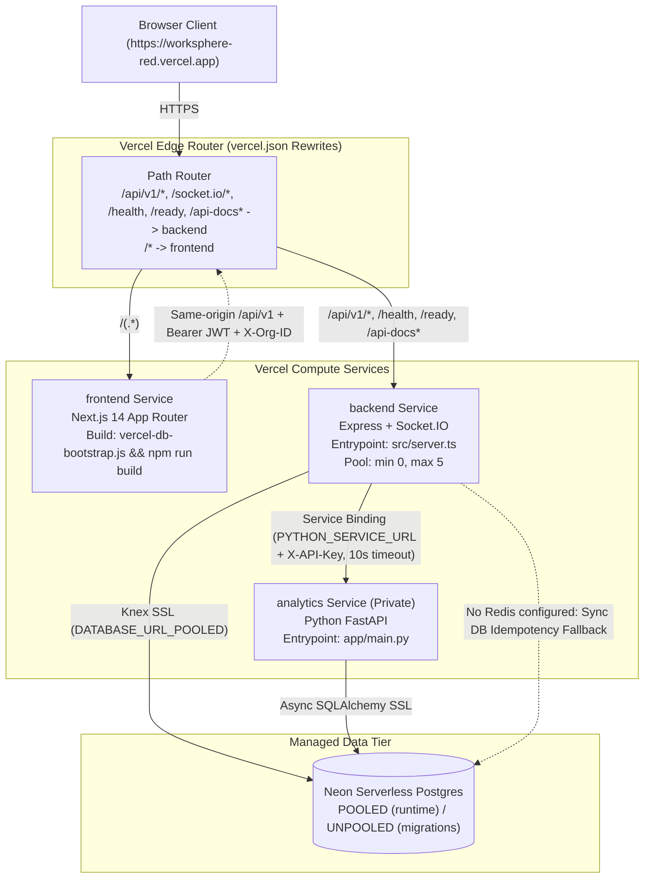
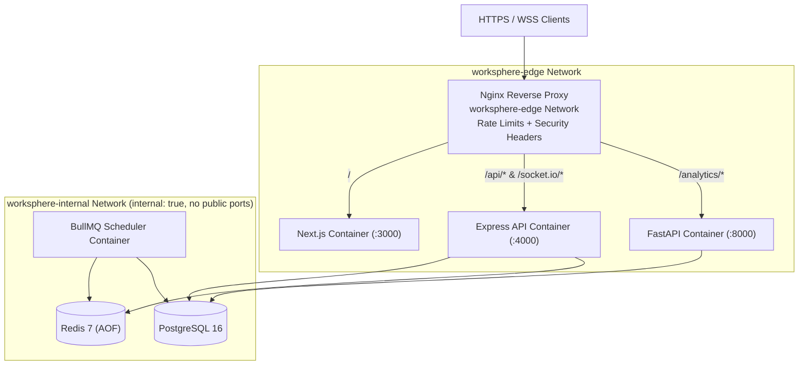
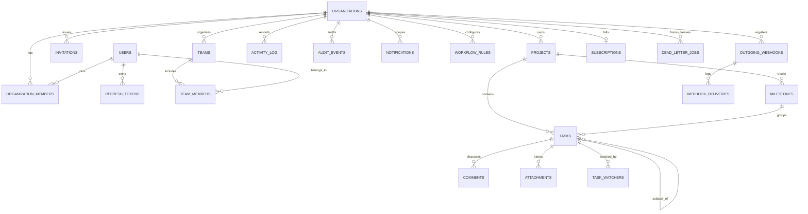
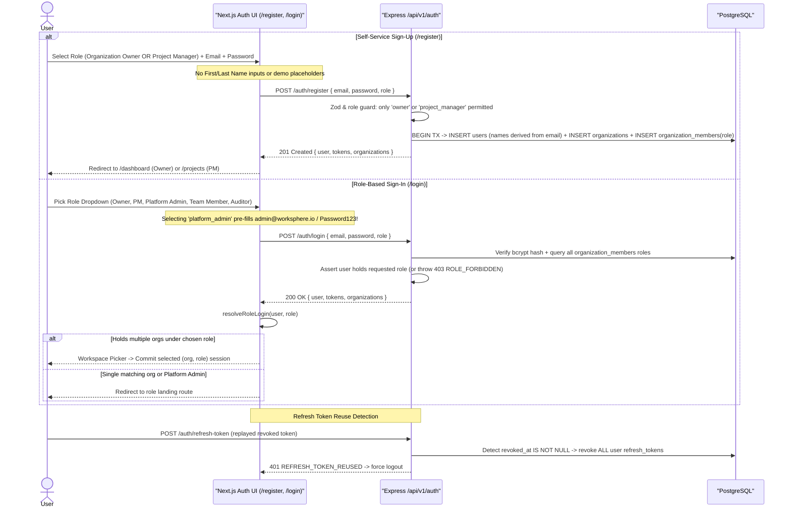
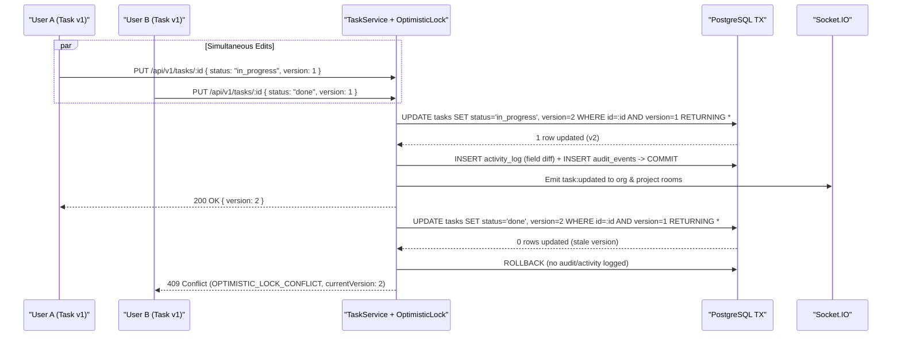
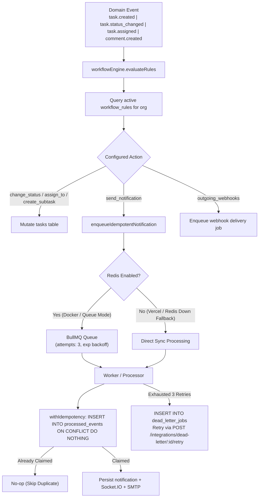
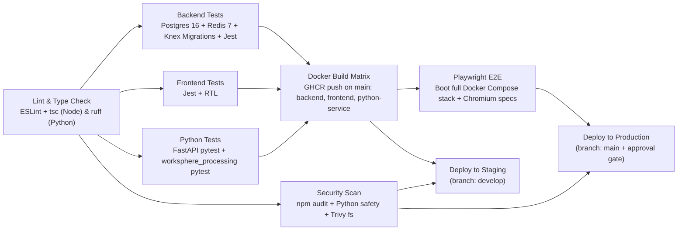

# WorkSphere — Complete Project, Workflow & Deployment Guide

> **Single-Source Engineering & Operations Handbook** covering WorkSphere's architecture, multi-tenant data model, role-based access control (RBAC) workflows, real-time and background pipelines, CI/CD automation, Docker/Nginx self-hosting, and live Vercel + Neon Serverless Postgres production deployment.

---

## 1. Executive Summary & Live Environment

**WorkSphere** is a multi-tenant SaaS project management and workflow automation platform built across TypeScript/Node.js, React/Next.js, Python/FastAPI, PostgreSQL, and Redis. Tenant organizations operate with strict server-side isolation enforced across HTTP middleware, SQL queries, Socket.IO rooms, and FastAPI analytics endpoints.

| Layer / Service | Stack | Responsibility | Entry Point / Location |
| --- | --- | --- | --- |
| **Frontend UI** | Next.js 14 (App Router), React 18, TypeScript, Tailwind CSS, Redux Toolkit, TanStack Query, React Hook Form + Zod | Role-based auth portals, workspaces, Kanban boards, teams, workflows, analytics, audit logs, admin console | [`frontend/`](../frontend) |
| **Core REST & WS API** | Node.js, Express, TypeScript, Knex.js, Zod, Socket.IO, Winston, Swagger UI | Auth/JWT rotation, RBAC & tenant context, optimistic locking, workflow automation, webhooks, notifications | [`backend/src/server.ts`](../backend/src/server.ts) |
| **Background Workers** | BullMQ + `ioredis` (with DB idempotency fallback when Redis disabled) | Notification delivery, deadline reminders, webhook delivery, analytics refresh | [`backend/src/jobs/scheduler.ts`](../backend/src/jobs/scheduler.ts) |
| **Analytics Microservice** | Python 3.11, FastAPI, Pydantic v2, async SQLAlchemy (`asyncpg`) | Tenant-scoped project health, workload distribution, cycle time, burndown, CSV/JSON report exports | [`python-service/app/main.py`](../python-service/app/main.py) |
| **Streaming ETL CLI** | Python (`worksphere_processing`) | Constant-memory lazy generator CSV/JSONL export processor & overdue detector | [`python-processing/`](../python-processing) |
| **System of Record** | PostgreSQL 16 (Neon Serverless Postgres on Vercel) | 22 normalized tables managed via 5 sequential Knex migrations + deterministic seed data | [`database/`](../database) |
| **Edge Proxy (Docker)** | Nginx + TLS/Security Headers + Rate Limiting | Rate limits (`/api/v1/auth/` `5r/s`, `/api/` `30r/s`), CORS, WebSocket upgrade proxy | [`nginx/nginx.conf`](../nginx/nginx.conf) |

- **Live Production URL (Vercel Services + Neon Postgres)**: `https://worksphere-red.vercel.app`
- **Core Health Endpoints**: `GET /health` (liveness), `GET /ready` (database + Redis readiness), `GET /metrics` (Prometheus & JSON telemetry), `GET /api-docs` (Swagger UI).

---

## 2. Complete Repository Structure

```text
Saas Model/
├── frontend/                       # Next.js 14 App Router UI, Redux auth slice, TanStack Query, Jest + Playwright
│   ├── next.config.mjs             # Standalone output for Docker; omitted automatically on Vercel
│   ├── src/app/(auth)/             # Unauthenticated Sign-In (/login) & Role-Based Sign-Up (/register)
│   ├── src/app/(dashboard)/        # Protected routes: dashboard, projects, tasks, teams, workflows, analytics, audit-logs, settings, admin
│   ├── src/lib/                    # api.ts (JWT + X-Org-ID interceptor & refresh queue), auth.ts, roles.ts
│   └── tests/                      # Component unit tests & Playwright Chromium E2E specs
├── backend/                        # Express API + Socket.IO + BullMQ workers
│   ├── knexfile.ts                 # Dev, test, staging, production Knex config (supports DATABASE_URL_UNPOOLED / ssl)
│   └── src/
│       ├── app.ts                  # Helmet, CORS, rate limiter, Stripe raw body, Swagger, /api/v1 router
│       ├── server.ts               # HTTP + Socket.IO server, conditional worker bootstrap, SIGTERM/SIGINT shutdown
│       ├── config/                 # index.ts, database.ts, redis.ts, swagger.ts
│       ├── middleware/             # authenticate.ts, tenantContext.ts, authorize.ts, validate.ts, requestId.ts, errorHandler.ts
│       ├── routes/v1/              # auth, organizations, projects, tasks, teams, notifications, workflow-rules, integrations, admin, activity
│       ├── controllers/, services/, repositories/
│       ├── jobs/ & websocket/      # scheduler.ts, DLQ persistence, 4 workers, socketManager.ts
│       └── utils/                  # optimisticLock.ts, idempotency.ts, logger.ts, metrics.ts, ApiError.ts
├── database/
│   ├── migrations/                 # 001..005 sequential Knex TypeScript migrations (22 tables)
│   └── seeds/001_seed_data.ts      # 2 orgs (Acme Corp, Globex Inc), 5 users spanning all 5 roles, projects, tasks, comments
├── python-service/                 # FastAPI analytics microservice (app/main.py, core/, api/, models/, services/)
├── python-processing/              # Streaming Python package (worksphere_processing CLI & lazy generators)
├── nginx/nginx.conf                # Self-hosted reverse proxy, TLS headers, rate limiting, WS upgrades
├── scripts/
│   ├── vercel-db-bootstrap.js      # Runs Knex migrate:latest & initial seed-if-empty during Vercel builds
│   ├── ensure-db.js                # Local database existence helper
│   ├── backup.sh & restore.sh      # Compressed pg_dump backup (level 9, 30-day retention) & verification restore
│   └── healthcheck.sh              # End-to-end health probe script across services, Postgres & Redis
├── .github/workflows/
│   ├── ci-cd.yml                   # Lint/TypeCheck -> Tests & Security Scan -> GHCR Docker Build -> E2E -> Deploy
│   └── rollback.yml                # Manual workflow_dispatch rollback by environment, commit SHA & reason
├── vercel.json                     # Vercel multi-service topology (frontend, backend, analytics) & path rewrites
├── docker-compose.yml              # Full local & dev Docker Compose topology (+ MailHog dev profile)
├── docker-compose.prod.yml         # Internal-only network isolation & production Docker build targets
└── docs/                           # Architecture diagrams, OpenAPI YAML, Postman collection, runbooks, this master guide
```

---

## 3. End-to-End Architecture & Deployment Topologies

WorkSphere supports **two first-class production topologies** from the same codebase:
1. **Vercel Services + Neon Serverless Postgres** (`vercel.json` — live at `https://worksphere-red.vercel.app`)
2. **Docker Compose + Nginx Reverse Proxy** (`docker-compose.yml` + `docker-compose.prod.yml`)

### 3.1 Vercel Multi-Service Production Topology (`vercel.json`)



### 3.2 Docker Compose Production Topology (`docker-compose.prod.yml`)



### 3.3 Express Core API Middleware Pipeline

Every API request under `/api/v1` passes through the ordered security & validation chain in [`backend/src/app.ts`](../backend/src/app.ts):

```mermaid
flowchart LR
    Req["HTTP Request"] --> ReqID["requestIdMiddleware\nX-Request-ID + Metrics"]
    ReqID --> Sec["Helmet + CORS + Compression\n+ Rate Limiter (120 req/min)"]
    Sec --> Router["/api/v1 Router"]
    Router --> Auth["authenticate Middleware\nJWT Verify -> req.user"]
    Auth --> Tenant["tenantContext Middleware\nX-Org-ID / :orgId Membership Check -> req.tenant"]
    Tenant --> RBAC["authorize(...roles)\nplatform_admin bypass or req.tenant.role check"]
    RBAC --> Val["validate(Zod Schema)\nRequest Body / Query / Params"]
    Val --> Handler["Controller -> Service -> Repository (Knex TX)"]
    Handler --> Err["Global errorHandler\nSafe JSON Errors (No Stack Leaks in Prod)"]
```



---

## 4. Database Schema & Persistence Model (22 Tables)

PostgreSQL 16 acts as the single system of record, provisioned via 5 sequential Knex TypeScript migrations ([`database/migrations/001`](../database/migrations/001_create_organizations.ts) through `005`):



| Migration | Tables Created | Key Constraints & Design Mechanisms |
| --- | --- | --- |
| **`001_create_organizations`** | `organizations`, `users`, `organization_members`, `invitations`, `refresh_tokens` | `UNIQUE(org_id, user_id)`, `CHECK(role IN ('owner','project_manager','team_member','auditor'))`, `CHECK(status IN ('pending','accepted','expired','revoked'))`, SHA-256 `token_hash` for refresh token reuse revocation |
| **`002_create_projects`** | `teams`, `team_members`, `projects`, `milestones` | `UNIQUE(team_id, user_id)`, `idx_projects_org_status`, `version` integer on `projects` for optimistic locking |
| **`003_create_tasks`** | `tasks`, `comments`, `attachments`, `task_watchers` | Self-referential `parent_task_id` & `parent_comment_id`, `PRIMARY KEY(task_id, user_id)`, `version` integer on `tasks` (`HTTP 409` on concurrent stale updates) |
| **`004_create_activity_and_audit`** | `activity_log`, `audit_events`, `notifications`, `workflow_rules`, `processed_events` | `UNIQUE(event_id)` on `processed_events` for atomic `INSERT ... ON CONFLICT DO NOTHING` worker idempotency |
| **`005_create_integrations_and_dlq`** | `outgoing_webhooks`, `webhook_deliveries`, `subscriptions`, `dead_letter_jobs` | `UNIQUE(delivery_id)`, `UNIQUE(org_id)` on `subscriptions`, Dead-Letter queue recovery table |

### 4.1 Deterministic Dev Seed Accounts ([`database/seeds/001_seed_data.ts`](../database/seeds/001_seed_data.ts))

When `users` is empty (initial local seed or first Vercel build), 2 organizations and 5 users (all using seeded demo password `Password123!`) are created:

| Email | Global Flag | Acme Corp Role | Globex Inc Role |
| --- | --- | --- | --- |
| `admin@worksphere.io` | `is_platform_admin = true` | `owner` | — |
| `alice@acme.com` | `false` | `project_manager` | `auditor` |
| `bob@acme.com` | `false` | `team_member` | — |
| `carol@globex.com` | `false` | — | `owner` |
| `dave@globex.com` | `false` | — | `project_manager` |

---

## 5. Authentication, Sign-Up & RBAC Workflows

WorkSphere strictly separates **self-service Sign-Up** (workspace creators/leads only) from **Sign-In** (all 5 workspace & admin roles) and protects every session with short-lived access JWTs (`15m`) and rotating refresh tokens (`7d`).



### 5.1 Role Permissions & Landing Routes Matrix

| Role | Self-Signup Allowed? | Sign-In Dropdown & Backend Auth | Landing Route | Capabilities & Route Guards (`authorize.ts` & `RoleGuard`) |
| --- | --- | --- | --- | --- |
| **Organization Owner** (`owner`) | **Yes** (creates default workspace) | **Yes** | `/dashboard` | Full tenant governance: update/delete org, manage members & invitations, teams, projects, milestones, tasks, workflow rules, outgoing webhooks, dead-letter recovery, billing, audit logs |
| **Project Manager** (`project_manager`) | **Yes** (creates default workspace) | **Yes** | `/projects` | Manage teams, invitations, projects, milestones, tasks/subtasks, comments, attachments, workflow rules, webhook listing, analytics |
| **Platform Admin** (`platform_admin`) | No (seeded / admin flag only) | **Yes** (auto-fills `admin@worksphere.io` / `Password123!` in UI) | `/admin` | Global platform stats (`/admin/stats`), all organizations & users telemetry (`/admin/organizations`, `/admin/users`), bypasses org membership checks when inspecting tenants |
| **Team Member** (`team_member`) | No (invited by Owner/PM) | **Yes** | `/tasks` | View org projects & analytics; create/update tasks, subtasks, comments, attachments, and watchers; restricted from `/workflows`, `/audit-logs`, `/admin` |
| **Auditor** (`auditor`) | No (invited by Owner/PM) | **Yes** | `/audit-logs` | Read-only compliance visibility (`/activity/audit-log`, read projects, tasks, teams, analytics); blocked from all mutations |

---

## 6. Core Runtime Workflows

### 6.1 Optimistic Locking & Concurrent Task Updates

To prevent silent last-write-wins overwrites, both `projects` and `tasks` carry an integer `version` column verified inside database transactions (`backend/src/utils/optimisticLock.ts`):



### 6.2 Workflow Automation, Idempotent Jobs & Dead-Letter Recovery



### 6.3 Analytics Proxy & Streaming Processing

- **Real-Time Analytics**: Next.js `/analytics` calls Express (`/api/v1/integrations/analytics/*`), which uses [`analyticsProxyService.ts`](../backend/src/services/analyticsProxyService.ts) to forward tenant-scoped requests (`?org_id=...` + `X-API-Key`, up to 2 attempts, `10s` timeout on Vercel / `5s` locally) to the private **FastAPI** service. FastAPI runs async SQLAlchemy queries strictly filtered by `org_id`. If FastAPI is unreachable, Express fails cleanly with `HTTP 503 SERVICE_UNAVAILABLE`.
- **Offline Streaming ETL (`worksphere_processing`)**: Lazy generator pipeline reading CSV/JSONL exports row-by-row in constant memory, validating via Pydantic schemas, computing productivity KPIs & overdue reports, and writing JSON/CSV summaries.

---

## 7. API Surface Overview

All REST endpoints are mounted under `/api/v1` (except health/metrics/Swagger probes at root):

| Endpoint Prefix | Purpose & Key Routes | Auth / Tenant Guards |
| --- | --- | --- |
| `/health`, `/ready`, `/metrics`, `/api-docs` | Liveness, DB/Redis readiness (`200` / `503`), Prometheus & JSON metrics, OpenAPI Swagger UI | Public probes |
| `/api/v1/auth` | `POST /register`, `POST /login`, `POST /refresh-token`, `POST /logout`, `GET /me` | Public for register/login/refresh; Bearer JWT for logout/me |
| `/api/v1/organizations` | CRUD orgs, list members, update/remove member role, create & accept email invitations | `authenticate` + `tenantContext` + `authorize('owner', 'project_manager')` |
| `/api/v1/teams` | CRUD teams, add/remove team members | `authenticate` + `tenantContext` + `authorize('owner', 'project_manager')` |
| `/api/v1/projects` | CRUD projects, milestones (`/milestones`), team assignment, version conflict protection | `authenticate` + `tenantContext` + role guards |
| `/api/v1/tasks` | CRUD tasks & subtasks, comments, S3/local file attachments (signed download URLs), watchers | `authenticate` + `tenantContext` + `authorize('owner', 'project_manager', 'team_member')` |
| `/api/v1/notifications` | List notifications, `GET /unread-count`, `PUT /:id/read` | `authenticate` + `tenantContext` |
| `/api/v1/workflow-rules` | CRUD event-condition-action automation rules | `authenticate` + `tenantContext` + `authorize('owner', 'project_manager')` |
| `/api/v1/integrations` | Analytics proxy (`/analytics/summary`, `/workload`, project metrics), outgoing webhooks, dead-letter queue (`GET /dead-letter`, `POST /:id/retry`), Stripe billing & webhook, RFC 5545 `.ics` export | `authenticate` + `tenantContext` + role guards (`stripe/webhook` uses raw body signature verification) |
| `/api/v1/admin` | Global cross-tenant telemetry (`/stats`, `/organizations`, `/users`) | `authenticate` + `requirePlatformAdmin` (`isPlatformAdmin === true`) |
| `/api/v1/activity`, `/api/v1/audit-log` | Activity feed & immutable audit log inspection | `authorize('owner', 'auditor')` for audit logs |

---

## 8. Deployment Workflows & Environment Configuration

### 8.1 Mode A — Local Development

**Option 1: Full Docker Compose Stack (+ MailHog)**
```bash
cp .env.example .env
docker compose --profile dev up -d --build
docker compose exec api npx knex migrate:latest
docker compose exec api npx knex seed:run
```
Endpoints: Frontend `http://localhost:3000`, API `http://localhost:4000/api/v1` (Swagger `/api-docs`), FastAPI `http://localhost:8000/docs`, MailHog `http://localhost:8025`.

**Option 2: Run Services Individually**
```bash
# 1. PostgreSQL schema & initial seed
cd backend && npx knex migrate:latest && npx knex seed:run

# 2. Backend Core API (:4000)
cd backend && npm install && npm run dev

# 3. Frontend Next.js (:3000)
cd frontend && npm install && npm run dev

# 4. FastAPI Analytics (:8000)
cd python-service && pip install -r requirements.txt && uvicorn app.main:app --reload --port 8000

# 5. Python Streaming CLI
cd python-processing && pip install -e . && worksphere-process sample_data/tasks_export.csv --output-dir ./reports
```

### 8.2 Mode B — Self-Hosted Production (`docker-compose.prod.yml` + Nginx)

`docker-compose.prod.yml` strips all public host port bindings from `postgres`, `redis`, `worker`, and `python-service`, isolating them on `worksphere-internal` (`internal: true`), while exposing only Nginx (`nginx/nginx.conf`) on `worksphere-edge`:

```bash
cp .env.example .env
# Populate real secrets in .env (never commit .env)
docker compose -f docker-compose.yml -f docker-compose.prod.yml up -d --build
docker compose exec api npx knex migrate:latest --env production
./scripts/healthcheck.sh
```

Container security controls:
- Multi-stage Docker builds (`target: production`) running as non-root `worksphere` (`uid=1001`) with container `HEALTHCHECK` directives.
- Nginx applies `X-Frame-Options`, `X-Content-Type-Options`, `Referrer-Policy`, CSP headers, gzip compression, and strict rate limits (`5r/s` on `/api/v1/auth/`, `30r/s` on `/api/`).

### 8.3 Mode C — Vercel Services + Neon Serverless Postgres (Live Production)

The live deployment at `https://worksphere-red.vercel.app` runs via [`vercel.json`](../vercel.json):
- **Services**:
  1. `frontend` (`frontend/`, `nextjs`): Runs `node ../scripts/vercel-db-bootstrap.js && npm run build`.
  2. `backend` (`backend/`, `express`, `src/server.ts`): Connected via service binding (`PYTHON_SERVICE_URL` injected from the `analytics` service).
  3. `analytics` (`python-service/`, `fastapi`, `app/main.py`): Private internal analytics microservice.
- **Automated Build-Time DB Bootstrap ([`scripts/vercel-db-bootstrap.js`](../scripts/vercel-db-bootstrap.js))**:
  - When `VERCEL` is set and `DATABASE_URL_UNPOOLED` / `DATABASE_URL` / `POSTGRES_URL` is configured, executes `knex migrate:latest --env production`.
  - Queries `SELECT COUNT(*)::int FROM users`; if empty (`0`), automatically runs `knex seed:run --env production`.
- **Serverless Runtime Adaptations**:
  - [`backend/src/server.ts`](../backend/src/server.ts): Skips `server.listen()` when `config.isVercel` is true and lets Vercel invoke the exported server/app handler.
  - [`backend/src/config/index.ts`](../backend/src/config/index.ts): Uses `DATABASE_URL_POOLED` / `DATABASE_URL` with SSL enabled and smaller pool bounds (`poolMin: 0, poolMax: 5`), sets `redis.enabled = false` unless `REDIS_URL`/`KV_URL` is explicitly attached (falling back cleanly to synchronous idempotent notification persistence so `/ready` reports `200 ready` with `redis: "disabled"`), routes local fallback file uploads to `os.tmpdir()`, raises analytics proxy timeout to `10000ms`, and whitelists `VERCEL_URL`, `VERCEL_BRANCH_URL`, and `VERCEL_PROJECT_PRODUCTION_URL` in CORS.
  - [`python-service/app/core/database.py`](../python-service/app/core/database.py): Converts `postgres://` / `postgresql://` URLs to `postgresql+asyncpg://` and translates Neon `sslmode` / strips `channel_binding` query flags cleanly for `asyncpg`.

### 8.4 Environment Variables Reference (Names Only — Never Commit Secrets)

| Category | Variable Names (from `.env.example` & runtime configs) | Notes |
| --- | --- | --- |
| **App & URLs** | `NODE_ENV`, `APP_NAME`, `APP_URL`, `API_URL`, `PYTHON_SERVICE_URL`, `NEXT_PUBLIC_API_URL`, `NEXT_PUBLIC_WS_URL` | On Vercel, `NEXT_PUBLIC_API_URL` targets `/api/v1` and `PYTHON_SERVICE_URL` is bound by `vercel.json` |
| **PostgreSQL / Neon** | `DATABASE_URL`, `DATABASE_URL_POOLED`, `DATABASE_URL_UNPOOLED`, `POSTGRES_URL`, `DATABASE_HOST`, `DATABASE_PORT`, `DATABASE_NAME`, `DATABASE_USER`, `DATABASE_PASSWORD`, `DATABASE_SSL`, `DATABASE_POOL_MIN`, `DATABASE_POOL_MAX` | Use unpooled URL for migrations (`knexfile.ts`) and pooled URL for runtime serverless queries |
| **Redis / BullMQ** | `REDIS_URL`, `KV_URL`, `REDIS_HOST`, `REDIS_PORT`, `REDIS_PASSWORD`, `REDIS_ENABLED` | Optional on Vercel; required for dedicated BullMQ worker containers |
| **Auth / Security** | `JWT_SECRET`, `JWT_ACCESS_EXPIRY`, `JWT_REFRESH_EXPIRY`, `BCRYPT_ROUNDS` | Minimum 32+ char high-entropy secret in production |
| **Analytics** | `ANALYTICS_SERVICE_API_KEY`, `API_KEY`, `ANALYTICS_DATABASE_URL`, `ANALYTICS_TIMEOUT_MS` | Shared secret (`X-API-Key`) between Express proxy & FastAPI |
| **Integrations & Logs** | `SMTP_HOST`, `SMTP_PORT`, `SMTP_USER`, `SMTP_PASSWORD`, `EMAIL_FROM`, `S3_ENDPOINT`, `S3_BUCKET`, `S3_ACCESS_KEY`, `S3_SECRET_KEY`, `S3_REGION`, `STRIPE_SECRET_KEY`, `STRIPE_WEBHOOK_SECRET`, `STRIPE_PRICE_ID`, `LOG_LEVEL`, `LOG_FORMAT` | Local JSON transport / tmpdir / Stripe sandbox fallbacks exist when optional creds omitted |

---

## 9. CI/CD Pipeline & Rollback Workflows

### 9.1 GitHub Actions CI/CD Pipeline ([`.github/workflows/ci-cd.yml`](../.github/workflows/ci-cd.yml))

Triggered on push to `main`, `develop`, `feature/**`, and PRs to `main` / `develop`:



On pushes to `main`, **Vercel Git Integration** also automatically builds and promotes the production deployment defined in [`vercel.json`](../vercel.json).

### 9.2 Rollback Workflow

- **GitHub Actions Manual Rollback** ([`.github/workflows/rollback.yml`](../.github/workflows/rollback.yml)): `workflow_dispatch` accepting `environment` (`staging` | `production`), `version` (target Git SHA/tag), and `reason`, checking out the target revision, re-deploying tagged images, and logging an incident record.
- **Vercel CLI Rollback / Re-Promote**: List deployments with `vercel ls` and promote a known-good production deployment URL via `vercel promote <deployment-url>`.

---

## 10. Backup, Monitoring & Incident Response Runbooks

### 10.1 Backup, Restore & Health Verification

```bash
# Compressed custom-format pg_dump backup (gzip level 9, 30-day retention)
./scripts/backup.sh production

# Restore & verification drill onto staging DB
./scripts/restore.sh ./backups/worksphere_production_YYYYMMDD_HHMMSS.sql.gz staging

# Verify all services, /ready probes, Postgres, and Redis
./scripts/healthcheck.sh
```

### 10.2 Incident Response Summary ([`docs/INCIDENT_RESPONSE.md`](./INCIDENT_RESPONSE.md))

| Incident Scenario | Automated Detection | Built-In Resilience & Mitigation |
| --- | --- | --- |
| **1. DB Latency / Pool Exhaustion** | `GET /ready` returns `503 {"status":"degraded","checks":{"database":"down"}}`; Winston JSON logs correlated by `X-Request-ID` | Inspect `pg_stat_activity`, tune `DATABASE_POOL_MAX`, scale read analytics to FastAPI |
| **2. Redis Outage / Queue Down** | `GET /ready` reports `redis: "down"` (`503`) when Redis enabled | Core REST API stays up; `notificationService` falls back to synchronous idempotent DB writes; replay missed jobs via DLQ once Redis recovers |
| **3. Duplicate Background Jobs** | Worker retries on transient failure (`attempts: 3`) | `withIdempotency()` claims unique `event_id` in `processed_events` (`ON CONFLICT DO NOTHING`) so duplicates skip cleanly |
| **4. SMTP / FastAPI Downstream Outage** | DLQ table entries; analytics proxy returns `503 SERVICE_UNAVAILABLE` after 2 attempts (`5s–10s` timeout) | Inspect `GET /api/v1/integrations/dead-letter` and replay after fix via `POST /api/v1/integrations/dead-letter/:id/retry` |
| **5. Concurrent Task Edit Conflict** | Client receives `HTTP 409 OPTIMISTIC_LOCK_CONFLICT` with `currentVersion` | `withOptimisticLock()` rejects stale version without writing audit/activity; UI prompts user to reload |
| **6. Cross-Tenant Access Attempt** | `403 TENANT_ACCESS_DENIED` or `404` on entity mismatch | Server-side `tenantContext` checks `organization_members`, and every SQL query / FastAPI read scopes strictly by `org_id` |
