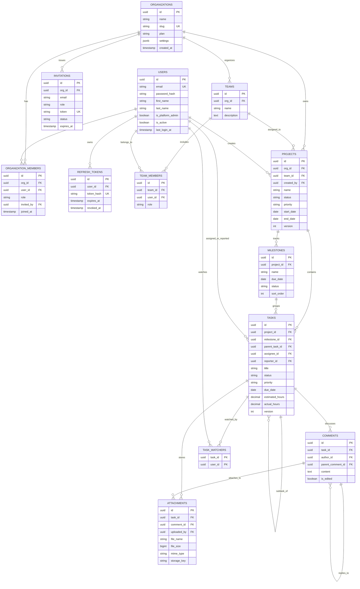
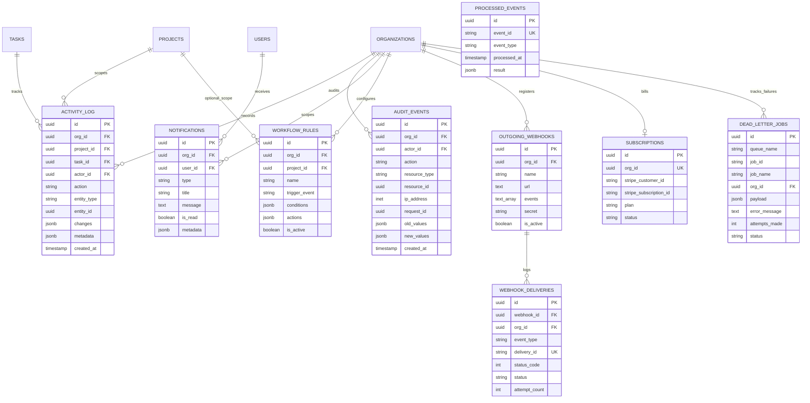

# WorkSphere — Database Entity-Relationship (ER) & Schema Guide

PostgreSQL 16 acts as the **single system of record** across WorkSphere, managed via **5 deterministic Knex migrations** (`database/migrations/001` through `005`) comprising **22 normalized tables**.

---

## 1. Core Multi-Tenant & Work Hierarchy ER Diagram (`001`–`003`)

---

## 2. Activity, Audit, Workflow, Idempotency & Integration ER Diagram (`004`–`005`)

---

## 3. Constraints, Indexes & Concurrency Decisions

| Migration | Table(s) | Key Constraints & Indexes | Design Rationale |
| --- | --- | --- | --- |
| `001` | `organizations`, `users`, `organization_members`, `invitations`, `refresh_tokens` | `UNIQUE(org_id, user_id)`, `CHECK(role IN ('owner','project_manager','team_member','auditor'))`, `CHECK(status IN ('pending','accepted','expired','revoked'))` | Prevents duplicate memberships; stores SHA-256 hashes of refresh tokens for instant reuse detection |
| `002` | `teams`, `team_members`, `projects`, `milestones` | `UNIQUE(team_id, user_id)`, `idx_projects_org_status`, `idx_projects_team`, `idx_milestones_project`, `version` integer | Composite `(org_id, status)` index accelerates filtered tenant listings; `version` enables conflict-safe project updates |
| `003` | `tasks`, `comments`, `attachments`, `task_watchers` | `CHECK(status ...)`, `CHECK(priority ...)`, `idx_tasks_project_status`, `idx_tasks_assignee`, `idx_tasks_parent`, `PRIMARY KEY(task_id, user_id)` | Self-referential `parent_task_id` and `parent_comment_id` model subtasks and threaded replies without extra join tables |
| `004` | `activity_log`, `audit_events`, `notifications`, `workflow_rules`, `processed_events` | `idx_activity_org_created`, `idx_activity_task`, `idx_audit_org_created`, `idx_notifications_user_read`, `UNIQUE(event_id)` on `processed_events` | `UNIQUE(event_id)` provides atomic idempotency claims (`INSERT ... ON CONFLICT DO NOTHING`) across workers |
| `005` | `outgoing_webhooks`, `webhook_deliveries`, `subscriptions`, `dead_letter_jobs` | `UNIQUE(delivery_id)`, `UNIQUE(org_id)` on `subscriptions`, `idx_webhooks_org_active`, `idx_dlq_queue_status` | Persists webhook delivery telemetry, single active subscription per org, and retryable dead-letter payloads |
