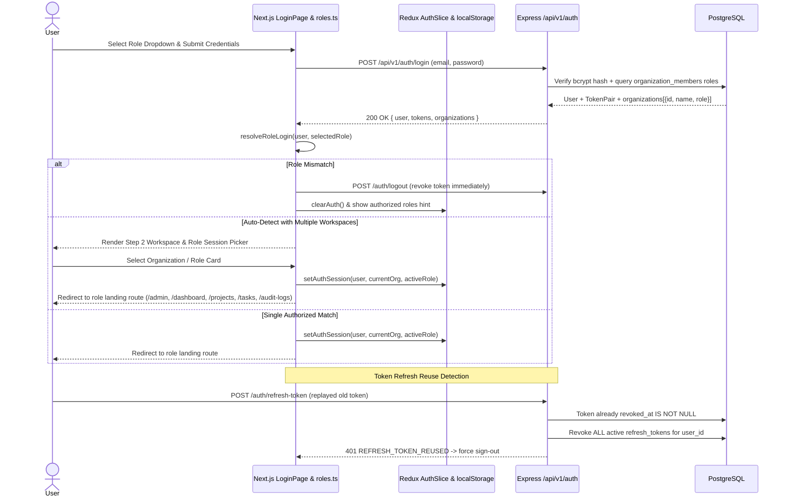
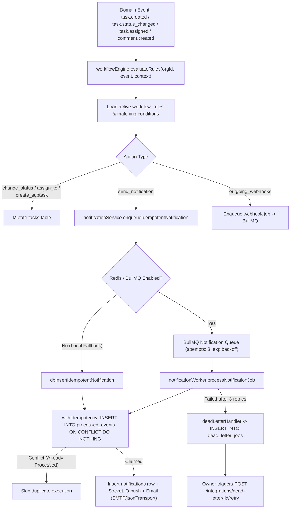
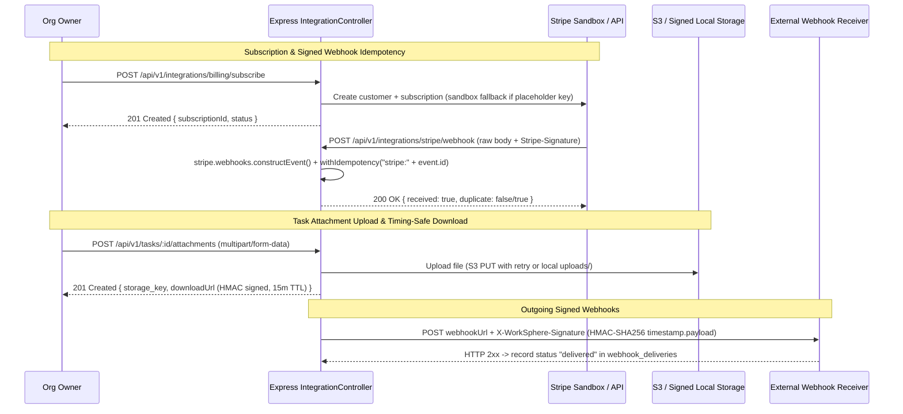
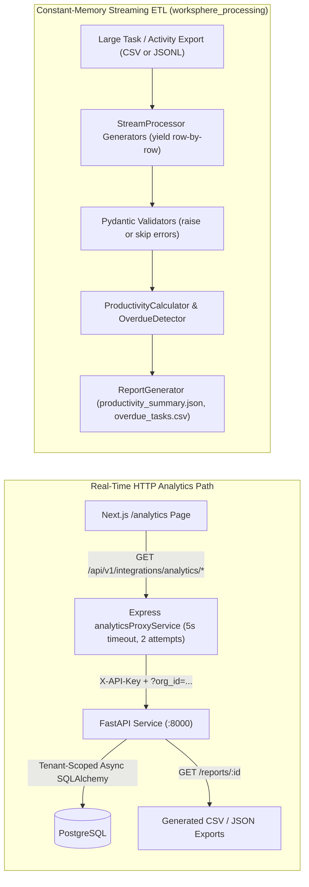

# WorkSphere — Service & Data-Flow Diagrams

This document details how requests, mutations, asynchronous jobs, webhooks, and analytics data flow across WorkSphere services.

---

## 1. Role-Based Login, Workspace Selection & Token Rotation



---

## 2. Concurrent Task Update (Optimistic Locking) & Atomic Audit Trail

```mermaid
sequenceDiagram
    participant UA as User A Browser (Task v1)
    participant UB as User B Browser (Task v1)
    participant API as Express TaskService
    participant DB as PostgreSQL Transaction
    participant WS as Socket.IO Server
    participant Q as Notification / Workflow Engine

    par Concurrent Edits on Same Task
        UA->>API: PUT /api/v1/tasks/:id { status: "in_progress", version: 1 }
        UB->>API: PUT /api/v1/tasks/:id { status: "done", version: 1 }
    end

    API->>DB: BEGIN TX -> UPDATE tasks SET status='in_progress', version=2 WHERE id=:id AND version=1
    DB-->>API: 1 row returned (version = 2)
    API->>DB: INSERT activity_log (field diff) + INSERT audit_events; COMMIT
    API->>WS: Emit task:updated to org, project, and task rooms
    API->>Q: Enqueue idempotent notification & evaluate workflow_rules
    API-->>UA: 200 OK { version: 2 }

    API->>DB: BEGIN TX -> UPDATE tasks SET status='done', version=2 WHERE id=:id AND version=1
    DB-->>API: 0 rows updated (current version is 2)
    API->>DB: ROLLBACK (no audit/activity written)
    API-->>UB: 409 Conflict (OPTIMISTIC_LOCK_CONFLICT, currentVersion: 2)
    UB->>UB: TaskDetail catches 409 -> displays warning & refreshes latest version
```

---

## 3. Workflow Automation, Idempotent Jobs & Dead-Letter Recovery



---

## 4. Third-Party Integrations & Outgoing Webhooks Data Flow



---

## 5. FastAPI Analytics Service & Streaming Python ETL Pipeline


