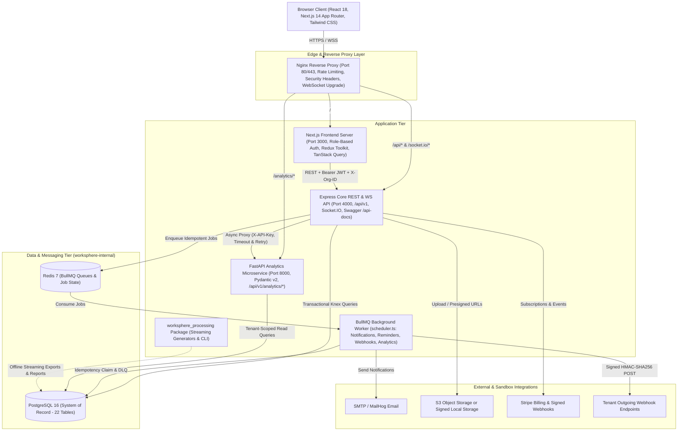

# WorkSphere — System Architecture & Engineering Blueprint

WorkSphere is a **multi-tenant SaaS project management and workflow automation platform**. Each tenant organization operates in strict logical isolation enforced on the server, while sharing a modular multi-service architecture across TypeScript/Node.js, React/Next.js, Python/FastAPI, PostgreSQL, and Redis.

> Related Guides:
> - [Database ER Diagram & Schema Reference](./DATABASE_SCHEMA.md) — All 22 PostgreSQL tables, constraints, indexes, and concurrency model
> - [Service & Data-Flow Diagrams](./DATA_FLOWS.md) — End-to-end sequence and flow diagrams for auth, optimistic locking, workflows, webhooks, and analytics
> - [Complete Codebase Guide](./CODEBASE_GUIDE.md) — Annotated folder-by-folder and module-by-module walkthrough of the repository
> - [Deployment Guide](../DEPLOYMENT.md) & [Incident Response Runbooks](../INCIDENT_RESPONSE.md)

---

## 1. High-Level System & Container Architecture

---

## 2. Express Core API Request & Middleware Pipeline

Every authenticated API call passes through a layered Express pipeline enforcing request correlation, security headers, rate limiting, JWT validation, tenant membership verification, role authorization, and schema validation before hitting business logic.

```mermaid
flowchart LR
    Req["Incoming HTTP Request"] --> ReqID["requestIdMiddleware (X-Request-ID & Metrics)"]
    ReqID --> Sec["Helmet + CORS + Compression + Rate Limiter"]
    Sec --> Router["/api/v1 Router"]
    Router --> Auth["authenticate Middleware (JWT Access Token Verify)"]
    Auth --> Tenant["tenantContext Middleware (X-Org-ID Membership Check)"]
    Tenant --> RBAC["authorize Middleware (owner, project_manager, team_member, auditor, platform_admin)"]
    RBAC --> Val["validate Middleware (Zod Schema Validation)"]
    Val --> Ctrl["Controller Layer (HTTP Mapping)"]
    Ctrl --> Svc["Service Layer (Transactions, Workflow Engine, Socket.IO, Audits)"]
    Svc --> Repo["Repository Layer (Knex + Optimistic Lock)"]
    Repo --> DB[("PostgreSQL")]
    Svc --> Err["Global errorHandler (Safe JSON Error, No Stack Leaks)"]
```

---

## 3. Service Boundaries & Authoritative Data Ownership

| Domain / Entity | Authoritative Service | Persistence & Access Pattern |
| --- | --- | --- |
| Users, Refresh Tokens, Organizations, Memberships, Invitations | **Express Core API** | Transactional PostgreSQL writes (`users`, `refresh_tokens`, `organizations`, `organization_members`, `invitations`) |
| Teams, Projects, Milestones, Tasks, Subtasks, Comments, Attachments, Watchers | **Express Core API** | Tenant-scoped SQL joins + `version`-based optimistic locking (`HTTP 409 Conflict`) |
| Activity Timeline, Immutable Audit Trail, Workflow Rules, Notifications | **Express Core API** | Recorded atomically inside mutation DB transactions (`activity_log`, `audit_events`, `workflow_rules`, `notifications`) |
| Project Health, Team Workload, Cycle Time, Delivery Burndown, Report Exports | **FastAPI Analytics Service** | Tenant-isolated (`WHERE org_id = :org_id`) async read queries against PostgreSQL |
| Offline Bulk CSV/JSONL Export Processing & Overdue Audits | **`worksphere_processing` Python Package** | Constant-memory lazy Python generator pipeline (`StreamProcessor`) |
| Async Queues, Retries & Dead-Letter Recovery | **Redis + BullMQ + PostgreSQL DLQ** | At-least-once BullMQ delivery guarded by PostgreSQL `processed_events` & `dead_letter_jobs` |

---

## 4. Role-Based Access Control (RBAC) & Frontend Portal Matrix

Authentication issues short-lived JWT access tokens (`15m`) and rotating refresh tokens (`7d`). Both frontend navigation (`frontend/src/lib/roles.ts`, `RoleGuard`, `Sidebar`, `Header`) and backend route middleware (`authorize.ts`, `tenantContext.ts`) enforce role boundaries:

| Role | Default Portal Landing | Authorized Modules & Capabilities |
| --- | --- | --- |
| **`platform_admin`** | `/admin` | Cross-tenant telemetry (`/admin/stats`), all organizations/users list, global platform management (`is_platform_admin = true`) |
| **`owner`** | `/dashboard` | Full organization governance: update/delete org, manage member roles, teams, invitations, projects, tasks, workflows, webhooks, billing, audit logs |
| **`project_manager`** | `/projects` | Manage teams & invitations, projects, milestones, tasks/subtasks, comments, attachments, workflow automation rules, analytics |
| **`team_member`** | `/tasks` | View org projects & analytics; create/update tasks, subtasks, comments, attachments, and watchers; restricted from `/workflows`, `/audit-logs`, `/admin` |
| **`auditor`** | `/audit-logs` | Read-only compliance visibility: inspect `/audit-log`, view projects, tasks, teams, and analytics; blocked from all write/mutation endpoints |
