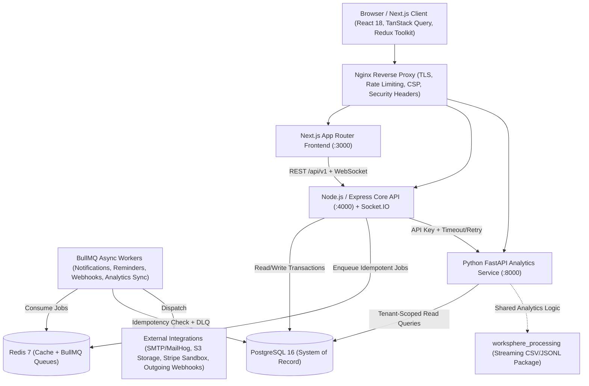
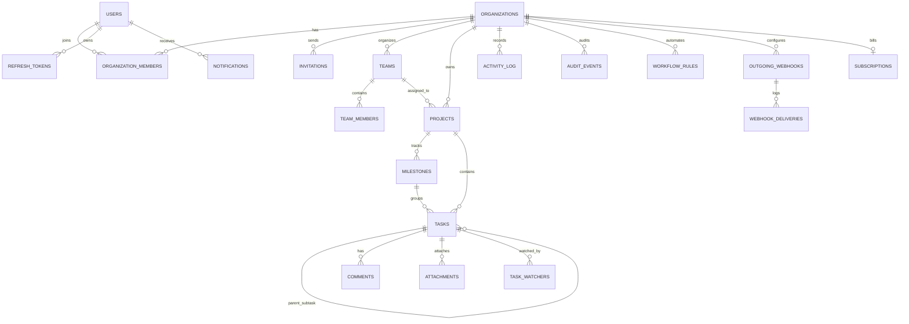

# WorkSphere Architecture, ER Model & Data-Flow Diagrams

## 1. High-Level System Architecture



## 2. Service Boundaries & Authoritative Data Ownership

| Entity / Domain | Authoritative Owner | Access Pattern |
| --- | --- | --- |
| Users, Refresh Tokens, Orgs, Memberships, Invitations | Express Core API + PostgreSQL | Transactional writes + JWT/RBAC verification |
| Teams, Projects, Milestones, Tasks, Subtasks, Comments, Attachments | Express Core API + PostgreSQL | Tenant-scoped queries + Optimistic Locking (`version`) |
| Activity Log, Audit Events, Workflow Rules, Notifications, DLQ, Subscriptions | Express Core API + PostgreSQL | Append-only audit/activity inside mutation transactions |
| Project Health, Workload, Cycle Time, Delivery Burndown, Streaming Reports | FastAPI Analytics Service + `worksphere_processing` | Read-only SQL aggregations scoped by `org_id` |
| Ephemeral Job Queues, Rate-Limit / Cache State | Redis + BullMQ | At-least-once delivery guarded by DB `processed_events` |

## 3. PostgreSQL Entity-Relationship (ER) Diagram



## 4. Concurrent Task Update & Idempotent Notification Flow (Capstone Challenge)

```mermaid
sequenceDiagram
    participant U1 as User A (v1)
    participant U2 as User B (v1)
    participant API as Express TaskService
    participant DB as PostgreSQL (tasks + activity_log + processed_events)
    participant Q as BullMQ / Redis
    participant W as NotificationWorker

    par Concurrent Edits
        U1->>API: PUT /tasks/:id { status: "in_progress", version: 1 }
        U2->>API: PUT /tasks/:id { status: "done", version: 1 }
    end

    API->>DB: BEGIN TX; UPDATE tasks SET status='in_progress', version=2 WHERE id=:id AND version=1
    DB-->>API: 1 row updated (version=2)
    API->>DB: INSERT activity_log + audit_events; COMMIT
    API-->>U1: 200 OK { version: 2 }

    API->>DB: BEGIN TX; UPDATE tasks SET status='done', version=2 WHERE id=:id AND version=1
    DB-->>API: 0 rows updated!
    API->>DB: ROLLBACK
    API-->>U2: 409 Conflict (OPTIMISTIC_LOCK_CONFLICT, currentVersion: 2)

    API->>Q: Enqueue notification (jobId = notif:task:<id>:v2:status:in_progress)
    Q->>W: Deliver Attempt #1
    W->>DB: INSERT INTO processed_events (event_id) ON CONFLICT DO NOTHING
    DB-->>W: Claimed -> Insert notification + send email
    Q->>W: Retry Attempt #2 (worker restart simulation)
    W->>DB: INSERT INTO processed_events (event_id) ON CONFLICT DO NOTHING
    DB-->>W: 0 rows -> Skipped! Zero duplicate notifications.
```
